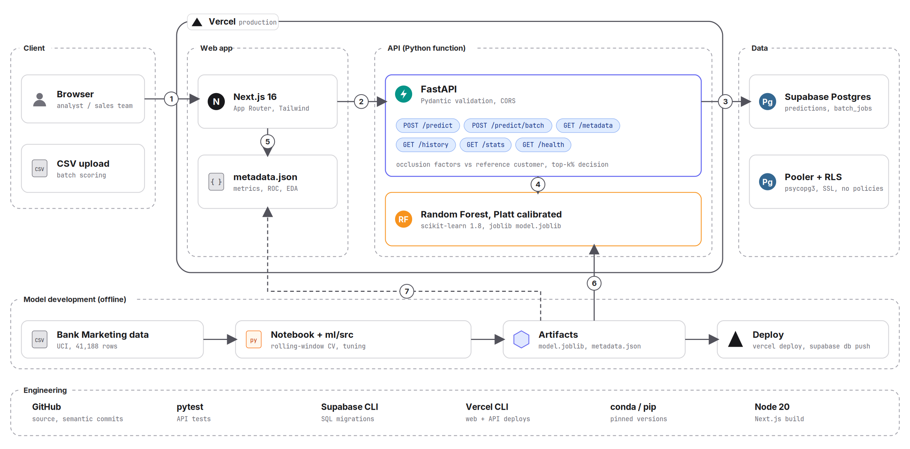

# Bank Marketing Prediction

Predicts which bank customers are likely to subscribe to a term deposit after a telemarketing call, so a call list can be ranked by score and limited to the customers worth calling.

- Dashboard: https://bank-marketing-web.vercel.app
- API: https://bank-marketing-api.vercel.app (interactive docs at `/docs`)



| # | Flow |
| --- | --- |
| 1 | The browser loads the Next.js dashboard from Vercel |
| 2 | Prediction, batch and history pages call the FastAPI service (JSON or CSV upload) |
| 3 | The API writes each prediction to Postgres in a background task and reads history and stats back |
| 4 | The API scores customers with the calibrated Random Forest loaded from `model.joblib` |
| 5 | Overview, Model and Data pages read bundled `metadata.json`, so they work without the API |
| 6, 7 | The notebook exports `model.joblib` and `metadata.json`, which are shipped with the API and the web app |

## Tech stack

| Layer | Choice |
| --- | --- |
| Model | scikit-learn Random Forest with Platt calibration (also compared: Logistic Regression, Decision Tree, SVM, HistGradientBoosting, LightGBM, soft voting) |
| Backend | FastAPI, Pydantic, joblib, psycopg 3 (Python 3.12) |
| Frontend | Next.js 16 (App Router), React 19, Tailwind CSS 4, Recharts |
| Database | Supabase Postgres (prediction log, Row Level Security enabled) |
| Hosting | Vercel for the web app, Vercel Python Functions for the API |
| Tooling | conda, pytest, Vercel CLI, Supabase CLI |

There is no Flask or Streamlit: the API is a separate FastAPI service and the dashboard is a Next.js app.

## Model

Data: [UCI Bank Marketing](https://archive.ics.uci.edu/dataset/222/bank+marketing), `bank-additional-full.csv` (41,188 rows, 11.3% positive). `duration` is excluded because it is only known after the call.

- Validation is chronological: the first 80% of rows train, the last 20% test, with rolling-window folds for tuning and robustness checks. A random split is reported only as a comparison because it is too optimistic for new customers.
- Metrics are AUC, ALIFT, PR-AUC, and the share of positives reached when only the top-k% of customers are called.
- The decision rule is capacity based (call the top 30% by score) rather than a fixed 0.5 threshold.

| Result on the out-of-time test set | Value |
| --- | --- |
| AUC | 0.728 |
| ALIFT | 0.658 |
| Top 30% called | reaches 51.3% of subscribers (lift 1.71x) |
| Most influential features | `pdays`, `month`, `poutcome` |

The test period has a much higher positive rate (30.8%) than the training period (6.4%), so absolute probabilities shift over time; ranking quality is the reliable output.

## API

| Endpoint | Purpose |
| --- | --- |
| `POST /predict` | Score one customer: probability, rank percentile, call or skip, top factors |
| `POST /predict/batch` | Score a CSV (up to 20,000 rows), ranked |
| `GET /metadata` | Feature schema, model metrics, curves |
| `GET /history`, `GET /stats` | Logged predictions and aggregate statistics |
| `GET /health` | Model version and database status |

Environment variables: `DATABASE_URL` (optional; logging is skipped without it), `CORS_ORIGINS`, `CORS_ORIGIN_REGEX`, `MODEL_DIR`.

## Deployment

- **Web**: the `web/` folder is a Vercel project. `NEXT_PUBLIC_API_URL` points to the API.
- **API**: `scripts/stage_api.sh <dir>` assembles `app/`, `bank_marketing/` and the artifacts into one folder, deployed with `vercel deploy --prod`. `DATABASE_URL` and `CORS_ORIGINS` are Vercel environment variables. The same folder also builds with `api/Dockerfile`. LightGBM is imported lazily so inference does not need system libraries missing on Vercel.
- **Database**: Supabase Postgres, schema in `supabase/migrations`, applied with `supabase db push`. Only the API connects (pooler connection string); the browser never talks to the database.

## Repository layout

| Path | Content |
| --- | --- |
| `ml/` | Dataset, notebook, shared training code (`src/bank_marketing`), exported artifacts |
| `api/` | FastAPI service and tests |
| `web/` | Next.js dashboard |
| `supabase/` | SQL migration for the prediction log |
| `scripts/` | Staging, metadata sync, and architecture diagram generator |
| `docs/` | Architecture diagram |

## Run locally

```bash
# model (re-export artifacts)
conda activate ml
pip install -r ml/requirements.txt
cd ml/notebooks && jupyter nbconvert --to notebook --execute --inplace model_development.ipynb && cd ../..
scripts/sync_metadata.sh

# API
pip install -r api/requirements.txt uvicorn pytest httpx
PYTHONPATH=ml/src:api uvicorn app.main:app --port 8010
pytest api/tests

# web
cd web && cp .env.example .env.local && npm install && npm run dev
```

Regenerate the diagram with `python scripts/make_architecture.py` (needs `cairosvg`).
